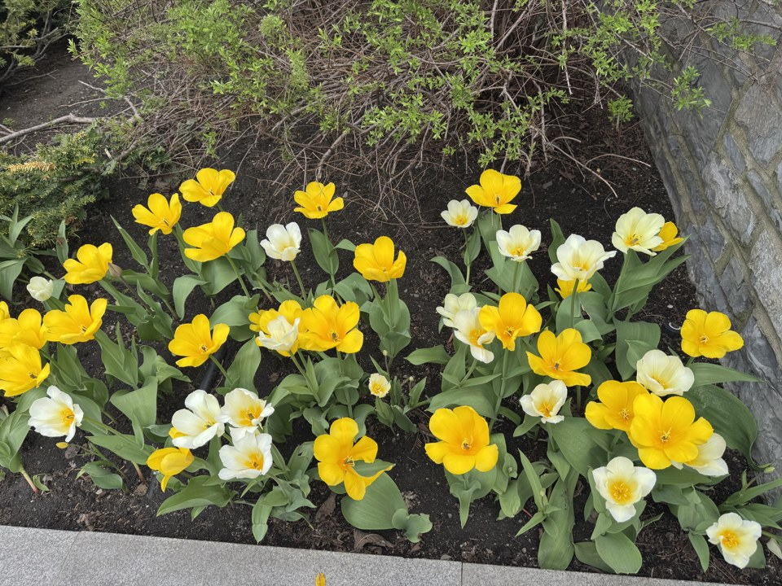

# Single Image → 3D Reconstruction

**English** | [中文](README.zh-CN.md)


Turn **one ordinary photo** into a **colored 3D point cloud** and a **triangle mesh**.
The pipeline estimates per-pixel depth with a pretrained monocular network (Depth Anything V2), back-projects every pixel through a pinhole camera model, and writes standard `.ply` / `.obj` files you can open in Blender, MeshLab, Open3D, Unity or Godot.

<p align="center">
  
</p>

## Features

- **One command, end to end.** Photo → depth map → point cloud → mesh → preview image.
- **Two depth backends.** Depth Anything V2 Small (default, via 🤗 Transformers) or MiDaS small (experimental, via `torch.hub`).
- **Runs anywhere.** Device is picked automatically: CUDA → Apple Silicon `mps` → CPU.
- **Dependency-light geometry.** Back-projection, meshing and `.ply`/`.obj` export are pure NumPy, with no Open3D required.
- **Clean meshes at object edges.** Triangles that span a large depth jump are dropped, so foreground objects don't get "welded" to the background.
- **Offline test mode.** `--use_fake_depth` checks the whole geometry pipeline without PyTorch or a model download.

## Quick start

```bash
git clone https://github.com/greenaandblue/Single-Image-to-3D-Reconstruction.git
cd Single-Image-to-3D-Reconstruction
python3 -m venv .venv && source .venv/bin/activate
pip install -r requirements.txt

python demo.py --image examples/tulips.jpg --out outputs
```

The first run downloads the model weights from Hugging Face (needs internet). Results land in `outputs/`:

| File | What it is |
|---|---|
| `depth.png` | Normalized depth map (brighter = farther) |
| `pointcloud.ply` | Colored point cloud (ASCII PLY) |
| `pointcloud_preview.png` | Static 3D preview rendered with Matplotlib, with no 3D viewer needed |
| `mesh.obj` | Triangle mesh; vertex colors use the common `v x y z r g b` extension |

<!--
Results: after running the demo, copy outputs/depth.png and outputs/pointcloud_preview.png
into docs/ and uncomment this table.

| Input | Depth | Point cloud |
|---|---|---|
|  |  |  |
-->

## Usage

```bash
python demo.py --image <photo> [--out outputs] [--backend depth_anything|midas]
               [--mode both|pointcloud|mesh] [--max_points 200000] [--use_fake_depth]
```

| Option | Default | Description |
|---|---|---|
| `--image` | required | Input photo (any format Pillow can read) |
| `--out` | `outputs` | Output folder |
| `--backend` | `depth_anything` | `depth_anything` (Depth Anything V2 Small) or `midas` (MiDaS small, experimental) |
| `--mode` | `both` | `pointcloud`, `mesh`, or `both` |
| `--max_points` | `200000` | Random down-sampling cap for the point cloud |
| `--use_fake_depth` | off | Skip the network and use a synthetic bowl-shaped depth map, useful for testing without PyTorch |

Use it from Python:

```python
from src.io_utils import load_image, save_point_cloud_ply
from src.depth_estimation import DepthEstimator
from src.geometry import CameraIntrinsics, depth_to_pointcloud

image = load_image("examples/tulips.jpg")             # (H, W, 3) uint8
depth = DepthEstimator("depth_anything").estimate(image)
h, w = image.shape[:2]
points, colors = depth_to_pointcloud(depth, image, CameraIntrinsics(width=w, height=h))
save_point_cloud_ply(points, colors, "tulips.ply")
```

## How it works

**1. Monocular depth.** `DepthEstimator` runs Depth Anything V2 (or MiDaS) and resizes the prediction back to the input resolution. Both networks output *relative*, disparity-like values (larger = closer), which are flipped so that larger = farther.

**2. Back-projection.** Each pixel $(u, v)$ with depth $Z$ becomes a 3D point using the pinhole model:

$$
X = \frac{(u - c_x)\,Z}{f_x}, \qquad Y = \frac{(v - c_y)\,Z}{f_y}
$$

Without real calibration, the intrinsics default to $f_x = f_y = 1.2\,W$ and $(c_x, c_y)$ at the image center. Pass real values to `CameraIntrinsics(...)` if you know your camera.

**3. Meshing.** Instead of Poisson reconstruction (meant for dense multi-view scans), the depth grid is triangulated directly: every 2×2 pixel block becomes two triangles. A triangle is skipped when its depth range exceeds `edge_threshold_ratio` (5 %) of its mean depth, which removes the stretched "curtain" faces along object boundaries.

## Performance tip

Meshing loops over every pixel in Python, so cost grows with resolution. On CPU, a 960×720 image takes about 18 s and produces a ~65 MB `.obj`. A full-resolution 24 MP phone photo would take many minutes and gigabytes, so **resize to ~1000 px first**:

```bash
sips -Z 1024 photo.jpg --out photo_small.jpg                                       # macOS
python -c "from PIL import Image; im=Image.open('photo.jpg'); im.thumbnail((1024,1024)); im.save('photo_small.jpg')"
```

## Limitations

- **2.5D, not a full model.** One view can't see the back or occluded parts, so the output is a "depth relief" surface, not a closed mesh.
- **No absolute scale.** Monocular depth is relative; sizes are proportional, not metric.
- **Estimated intrinsics.** Shapes look plausible, but they are not calibrated measurements.

## Project structure

```
├── demo.py                  End-to-end CLI
├── requirements.txt
├── src/
│   ├── depth_estimation.py  DepthEstimator (Depth Anything V2 / MiDaS)
│   ├── geometry.py          CameraIntrinsics, depth → point cloud / mesh (NumPy)
│   ├── io_utils.py          Image loading, depth PNG, PLY / OBJ writers
│   └── visualize.py         Matplotlib preview, optional Open3D viewer
├── examples/                Sample inputs (+ sample_output/ from the synthetic-depth test)
└── docs/pipeline.svg
```

## Ideas for extension

- **Real-time:** feed webcam frames to `DepthEstimator` for a live depth / point-cloud demo.
- **Multi-view fusion:** back-project several photos of one object and register them with ICP to fill in hidden surfaces.
- **NeRF / Instant-NGP:** train on 20–50 views for photorealistic, complete scenes.
- **Open3D post-processing:** statistical outlier removal, normal estimation and Poisson reconstruction for smoother, watertight meshes.

## Acknowledgments

- [Depth Anything V2](https://github.com/DepthAnything/Depth-Anything-V2) (`depth-anything/Depth-Anything-V2-Small-hf` on Hugging Face)
- [MiDaS](https://github.com/isl-org/MiDaS) by Intel ISL

## Author

**Huihang Liu** · Computer Engineering, Penn State · [@greenaandblue](https://github.com/greenaandblue)
