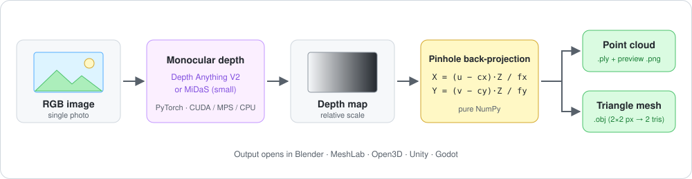

# 单张图片 → 3D 重建

[English](README.md) | **中文**

单目视觉 3D 重建：从**一张普通照片**估计深度，重建出**彩色点云**和**三角网格**，导出 `.ply` / `.obj`，可以直接用 Blender、MeshLab、Open3D、Unity、Godot 打开。

<p align="center">
  
</p>

## 特点

- **一条命令跑完整流程**：图片 → 深度图 → 点云 → 网格 → 预览图。
- **两种深度后端**：Depth Anything V2 Small（默认，HuggingFace Transformers）和 MiDaS small（实验性，`torch.hub`）。
- **自动选择设备**：CUDA → Apple Silicon `mps` → CPU。
- **几何部分只依赖 NumPy**：反投影、三角化、`.ply`/`.obj` 导出都不需要 Open3D。
- **边缘不"穿帮"**：深度跳变过大的三角形会被跳过，前景不会和背景粘在一起。
- **离线测试模式**：`--use_fake_depth` 不装 PyTorch、不下载模型也能验证整条几何流程。

## 快速开始

```bash
git clone https://github.com/greenaandblue/Single-Image-to-3D-Reconstruction.git
cd Single-Image-to-3D-Reconstruction
python3 -m venv .venv && source .venv/bin/activate
pip install -r requirements.txt

python demo.py --image examples/tulips.jpg --out outputs
```

第一次运行会从 HuggingFace / torch hub 下载模型权重，需要联网。

更多用法：

```bash
# 只要点云
python demo.py --image your_photo.jpg --out outputs --mode pointcloud

# 只要网格（.obj，可以直接拖进 Blender）
python demo.py --image your_photo.jpg --out outputs --mode mesh

# 没装 torch，想先测试点云/网格代码本身对不对
python demo.py --image examples/test_input.jpg --out outputs --use_fake_depth
```

输出：

| 文件 | 说明 |
|---|---|
| `outputs/depth.png` | 深度图（灰度，越亮越远） |
| `outputs/pointcloud.ply` | 彩色点云，可用 MeshLab / Open3D / Blender 打开 |
| `outputs/pointcloud_preview.png` | 静态预览图，不需要任何 3D 软件就能看效果 |
| `outputs/mesh.obj` | 三角网格，可直接拖进 Blender / Unity / Godot |

## 命令行参数

| 参数 | 默认值 | 说明 |
|---|---|---|
| `--image` | 必填 | 输入图片路径 |
| `--out` | `outputs` | 输出目录 |
| `--backend` | `depth_anything` | `depth_anything` 或 `midas`（实验性） |
| `--mode` | `both` | `pointcloud`、`mesh` 或 `both` |
| `--max_points` | `200000` | 点云最多保留的点数（随机降采样） |
| `--use_fake_depth` | 关闭 | 跳过深度模型，用合成的"碗状"深度图测试流程 |

## 原理说明

### 1. 深度估计

`src/depth_estimation.py` 里的 `DepthEstimator` 支持两个后端：

- `depth_anything`（推荐）：HuggingFace 上的 `Depth-Anything-V2-Small`，速度快、效果好，CPU 也能跑（会比较慢）。
- `midas`：`intel-isl/MiDaS` 的 `MiDaS_small`，通过 `torch.hub` 加载。

两者输出的都是**相对深度**（类似视差，越大越近），代码里统一翻转成"越大越远"。单张 2D 图片本质上无法恢复真实世界的绝对尺度，这是单目重建的固有限制。

### 2. 深度图 → 点云

`src/geometry.py` 里的 `depth_to_pointcloud`，用针孔相机模型：

```
Z = depth
X = (u - cx) * Z / fx
Y = (v - cy) * Z / fy
```

因为没有真实相机的内参（fx, fy, cx, cy），代码里用经验值估算（`CameraIntrinsics` 默认 `fx = fy = width * 1.2`，主点在图像中心），这样重建出来的形状比例是合理的，但不代表真实物理尺寸。如果知道相机的真实焦距/传感器参数，可以在 `CameraIntrinsics(...)` 里手动传入。

### 3. 点云 → 网格

没有用 Poisson 重建（那个更适合处理稠密、多视角扫描得到的点云），而是直接把深度图按像素网格三角化（每个 2×2 像素格子拆成 2 个三角形），这是单张深度图转 mesh 最直接、最快的方法。为了避免物体边缘和背景被错误地"焊"在一起形成拉长的面片，加入了深度断层检测（`edge_threshold_ratio`），深度跳变过大的三角形会被跳过。

## 在 Python 里调用

```python
from src.io_utils import load_image, save_point_cloud_ply
from src.depth_estimation import DepthEstimator
from src.geometry import CameraIntrinsics, depth_to_pointcloud

image = load_image("examples/tulips.jpg")
depth = DepthEstimator("depth_anything").estimate(image)
h, w = image.shape[:2]
points, colors = depth_to_pointcloud(depth, image, CameraIntrinsics(width=w, height=h))
save_point_cloud_ply(points, colors, "tulips.ply")
```

## 性能提示

三角化是逐像素的 Python 循环，耗时随分辨率增长。CPU 上 960×720 的图大约 18 秒，生成约 65 MB 的 `.obj`；手机原图（2400 万像素）会慢很多、文件也会到 GB 级，所以**建议先缩到 1000 像素左右**：

```bash
sips -Z 1024 photo.jpg --out photo_small.jpg     # macOS 自带
```

## 局限性

- 单张图片**无法**恢复背面/被遮挡部分的几何：输出的是"深度浮雕"式的 2.5D 网格，不是完整的封闭 3D 模型。
- 深度是相对值，没有真实尺度。
- 相机内参是估算值，不是真实标定结果。

## 目录结构

```
├── demo.py                  # 主入口
├── requirements.txt
├── src/
│   ├── depth_estimation.py  # 深度估计（Depth Anything V2 / MiDaS）
│   ├── geometry.py          # 深度图 → 点云 / 网格（纯 NumPy）
│   ├── io_utils.py          # 读图 / 存 obj / ply
│   └── visualize.py         # matplotlib 预览 + open3d 交互查看
├── examples/                # 示例图片（sample_output/ 是合成深度测试的结果）
└── docs/pipeline.svg
```

## 进阶方向

1. **实时版本**：把摄像头逐帧输入 `DepthEstimator`，做成实时深度 / 点云可视化 demo。
2. **多视角融合**：拍同一物体的多张照片，各自反投影出点云后用 ICP 对齐、合并，重建出更完整的模型。
3. **NeRF / Instant-NGP**：用 20～50 张多视角照片训练神经辐射场，能得到照片级的完整 3D 场景，但训练成本更高。
4. **Open3D 后处理**：点云降噪（statistical outlier removal）、法线估计 + Poisson 重建，得到更平滑、封闭的网格。
